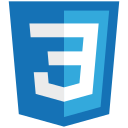

# Juan Antonio Coronado Palacios

**Estudiante de Ingeniería de Software**

Me gusta explorar nuevas tecnologías, experimentar con ideas y convertirlas en proyectos reales. Aprendo mientras construyo, desde programas de consola hasta aplicaciones con interfaces, algoritmos y datos.

[Portafolio](https://juan-coronado.github.io/) · [LinkedIn](https://www.linkedin.com/in/juan-antonio-coronado-palacios-6100b6329/) · [Correo](mailto:juanantoniocoronadopalacios@gmail.com)

## CargoMesh: dos hackatones internacionales, un proyecto en equipo

### CargoMesh 1 — OpenAI · The WebMCP Challenge

Desarrollamos en grupo la primera versión de CargoMesh para conectar solicitudes de transporte B2B, portales de proveedores y agentes mediante **WebMCP**. Trabajamos en consulta de cobertura y capacidad, cotizaciones, comparación de ofertas, reservas y resultados persistidos, manteniendo el control humano sobre las decisiones comerciales.

Participamos en **The WebMCP Challenge**, organizada por **OpenAI**, del **25 de agosto al 4 de septiembre de 2026**. La arquitectura de esta etapa combina Next.js, React, TypeScript y Supabase/PostgreSQL, con herramientas WebMCP expuestas por los proveedores.

[Hackatón de OpenAI](https://webmcp.devpost.com/) · [Participación en Devpost](https://devpost.com/software/cargomesh) · [Caso de CargoMesh 1](https://juan-coronado.github.io/projects/cargomesh-1/)

### CargoMesh 2 — Amazon · Build, Ship, Shape

Evolucionamos el producto en equipo para **Build, Ship, Shape: Amazon Developer Hackathon 2026**. La segunda etapa reúne portales Cliente y Carrier, solicitudes, ofertas, reservas y vistas de seguimiento, con backend compartido, datos por organización, un asistente de IA para la página web con **Amazon Nova mediante la API de Amazon Bedrock**, mapas e integración MCP autenticada.

El proyecto incorpora visualización 3D con **23 diseños de camiones y 15 arquitecturas de sedes**. Utiliza TypeScript, JavaScript, Python, SQL, Next.js, React, Hono, Supabase/PostgreSQL, Three.js, Google Maps Platform, Amazon Nova, Amazon Bedrock, Strands, AWS y Vercel, entre otras herramientas del equipo.

La convocatoria de **Amazon** admitió entregas del **31 de agosto al 23 de octubre de 2026**. La documentación identifica Alexa+ como línea principal y trabajo relacionado con AWS Builder y Open Source. El calendario oficial prevé anunciar ganadores el **3 de diciembre de 2026**; no se afirma un resultado final.

[Hackatón de Amazon](https://amazonappdev2026.devpost.com/) · [Ver CargoMesh](https://cargomesh.vercel.app/) · [Repositorio del equipo](https://github.com/Chujutak2024/cargomesh) · [Caso de CargoMesh 2](https://juan-coronado.github.io/projects/cargomesh/)

Ambas experiencias reconocen el desarrollo conjunto, sin atribuir todos sus componentes a una sola persona. Las escenas 3D son referencias visuales, no GPS ni flota real; la experiencia web con Nova y MCP no equivale a una integración Alexa+ verificada en un dispositivo Echo.

## Tecnologías que he utilizado o explorado

  
  
  
  
  
  
  
  
  
  
  

Las he utilizado en proyectos académicos o explorado durante mi formación. Cada repositorio explica su alcance y las comprobaciones disponibles.

## Proyectos y aprendizaje

Ordenados por dificultad, desde mis primeros programas hasta sistemas con estructuras de datos, algoritmos e integración de servicios.

| Dificultad | Proyecto | Periodo original | Tecnologías y conceptos |
| --- | --- | --- | --- |
| Inicial | [Agencia de viajes](https://github.com/Juan-Coronado/agencia-viajes-cpp) | Noviembre de 2022 | C++, Funciones, Validación |
| Inicial | [Reservas turísticas](https://github.com/Juan-Coronado/reservas-viajes-java) | Noviembre de 2023 | Java, Swing, Archivos |
| Intermedia | [Gestión inmobiliaria](https://github.com/Juan-Coronado/inmobiliaria-poo2) | 2024-I | Java, MVC, POO |
| Intermedia | [Metropolitano: datos](https://github.com/Juan-Coronado/metropolitano-datos) | 2024-I | SQL Server, SQL, Modelado |
| Intermedia | [Metropolitano: mi tarjeta](https://github.com/Juan-Coronado/metropolitano-web) | 2024-II | C#, ASP.NET MVC, Razor |
| Intermedia | [Inventario agrícola](https://github.com/Juan-Coronado/inventario-agricola) | Noviembre de 2024 | C++, Listas enlazadas, Persistencia |
| Intermedia | [Logística con autómatas](https://github.com/Juan-Coronado/distribucion-logistica) | 2025-I | C++, Autómatas, JFLAP |
| Avanzada | [JImport: migración de datos](https://github.com/Juan-Coronado/jimport-oracle) | 2024-II | SQL Server, Oracle 19c, Migración |
| Avanzada | [EuroSky Connect](https://github.com/Juan-Coronado/eurosky-connect) | Junio de 2026 | C++, JavaScript, Grafos |
| Avanzada | [Multimedia hospitalaria](https://github.com/Juan-Coronado/multimedia-hospitalaria) | Junio de 2026 | C++17, Hash y trie, Árbol rojo-negro |
| Avanzada | [CargoMesh 1 · hackatón OpenAI](https://juan-coronado.github.io/projects/cargomesh-1/) | Agosto–septiembre de 2026 | TypeScript, React, WebMCP y Supabase |
| Avanzada | [CargoMesh 2 · en equipo](https://github.com/Chujutak2024/cargomesh) | Septiembre–octubre de 2026 | Next.js, TypeScript, backend, IA, mapas y 3D |

JImport es un caso documentado, sin una migración Oracle ejecutada. Las fechas corresponden a los trabajos originales; los repositorios identifican por separado la revisión asistida de octubre de 2026 y el contexto académico de cada entrega.

## Mi recorrido

- **Fundamentos:** funciones, validación, POO y aplicaciones de escritorio.
- **Aplicaciones y datos:** MVC, SQL, persistencia, listas enlazadas y máquinas de estados.
- **Algoritmos:** grafos, búsqueda de rutas, índices y estructuras de datos avanzadas.
- **Hackatones internacionales:** colaboración en equipo, WebMCP con OpenAI y evolución de CargoMesh con Nova y servicios de AWS para Amazon.

Siempre abierto a intercambiar ideas y participar en proyectos que me permitan seguir aprendiendo.
